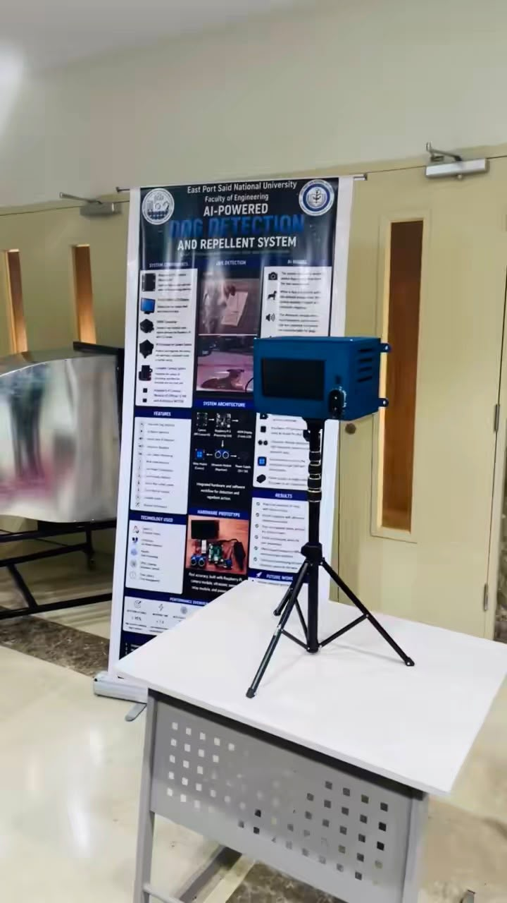
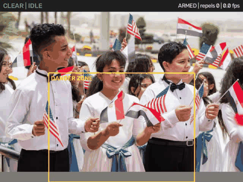
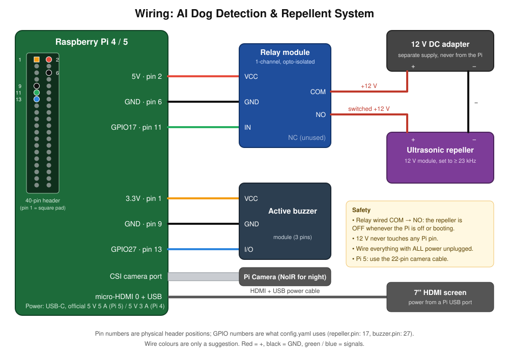

<div dir="rtl">

# نظام كشف وطرد الكلاب بالذكاء الاصطناعي

**[English](README.md)**

جهاز يعتمد على **Raspberry Pi** وكاميرا، يتعرّف على الكلاب باستخدام شبكة عصبية **YOLO**، وعندما
يقترب كلب أكثر من اللازم يشغّل **جهاز طرد بالموجات فوق الصوتية** (صوت أعلى من مدى سمع الإنسان
يزعج الكلاب) فيبتعد الكلب بطريقة آمنة لا تؤذيه. في نفس الوقت يصدر **بازر** صوتًا مسموعًا لتنبيه
الناس، ويمكن متابعة الفيديو المباشر على الشاشة 7 بوصة أو من الموبايل.

مناسب **للحضانات والمدارس والبيوت وأي مكان تمثل فيه الكلاب الضالة خطرًا على الأطفال**.
مشروع تخرج: كلية الهندسة، جامعة شرق بورسعيد الأهلية.

<p align="center"></p>

## جرّبه في دقيقة (من غير أي هاردوير)

<p align="center"></p>

أطفال وقطة شارع بيعدّوا ومفيش حاجة بتحصل. بعدين كلب شارع مصري بيقرب: البازر بيصفّر، وجهاز الطرد بيشتغل
على دفعات، ولما الكلب يمشي النظام بيهدى. البازر والريلاي محاكاة، وكل الباقي هو نفس الكود اللي بيشتغل على الراسبيري.

| فين | إزاي |
|---|---|
| **الكمبيوتر بتاعك** (ويندوز / ماك / لينكس، Python 3.10+) | الـ 4 أوامر اللي تحت |
| **من المتصفح بس، من غير تسطيب** | [](https://colab.research.google.com/github/mazenelnaghy-code/dog-detection/blob/main/notebooks/demo_colab.ipynb): شغّل العرض و**ارفع صورتك انت** |
| **GitHub Codespaces** | [](https://codespaces.new/mazenelnaghy-code/dog-detection) وبعدين `python -m dog_repeller --demo --no-window` وافتح البورت 8000 |
| **Docker** | `docker build -t dog-repeller .` وبعدين `docker run --rm -p 8000:8000 dog-repeller` وافتح http://localhost:8000 |

```bash
git clone https://github.com/mazenelnaghy-code/dog-detection.git && cd dog-detection
python -m venv .venv && .venv\Scripts\activate       # لينكس/ماك: source .venv/bin/activate
pip install -r requirements.txt && pip install --no-deps -e .
python -m dog_repeller --demo                        # نافذة فيديو + لوحة تحكم على http://127.0.0.1:8000
```

## فكرة العمل

1. **الكشف:** موديل YOLO11n (نسخة *nano* الخفيفة والسريعة المناسبة للراسبيري) يكتشف الكلاب في كل
   فريم. على الراسبيري يشتغل بصيغة **NCNN** وهي الأسرع على معالجات الراسبيري. النموذج الأصلي كان
   بيستخدم YOLOv8n وده لسه شغال. لما جرّبنا على **236 صورة لكلاب شوارع مصرية**، الموديل الجاهز كان كتير
   بيسمّي الكلب البلدي "بقرة" أو "دب" أو "خروف"، فبقينا نعتبر الأسماء دي كمان كلب. القطط والناس عمرهم
   ما بيتحسبوا. كده نسبة الكلاب اللي اتكشفت طلعت من 72% لـ **97%**.
   التفاصيل في [docs/EVALUATION.md](docs/EVALUATION.md).
2. **تقدير الخطر:** نحط **نقطة في منتصف** المربع (Bounding Box) حوالين كل كلب. لو النقطة دخلت
   **منطقة الخطر** المرسومة على الشاشة، أو المسافة المقدّرة للكلب أقل من الحد المسموح، يبقى الكلب خطر.
   المسافة محسوبة من الكاميرا نفسها بقانون العدسة `D = f·H / h`: كل ما الكلب قرب كل ما المربع كبر،
   فمش محتاجين حساس مسافة.
3. **التأكيد:** لازم الكلب يظهر في 3 فريمات على الأقل من آخر 6، عشان فريم غلط واحد ما يشغّلش الجهاز.
4. **التنفيذ:** البازر يصفّر للناس، والريلاي يشغّل جهاز الطرد **5 ثواني**، ثم راحة **3 ثواني**،
   ويتكرر طول ما الكلب موجود. بعد 6 مرات متتالية يرتاح النظام **60 ثانية** لحماية الجهاز وعشان
   الكلاب ما تتعودش على الصوت.

## التشغيل على الكمبيوتر بالكاميرا أو بفيديوهاتك

بعد التسطيب اللي فوق:

```bash
python -m dog_repeller --sim                                                 # كاميرا اللابتوب
python -m dog_repeller --sim --source my_dog.mp4 --set camera.realtime=true  # فيديو بسرعته الحقيقية
python -m dog_repeller --sim --source samples/dogs --loop                    # فولدر صور
python -m dog_repeller --sim --source my_dog.mp4 --record result.mp4         # احفظ الفيديو بالرسومات
```

الموديل `yolo11n.pt` بيتحمّل تلقائيًا أول مرة. افتح **http://127.0.0.1:8000** للوحة التحكم.
في نافذة الفيديو: `q` خروج، `a` تشغيل النظام، `d` إيقاف، `t` تجربة جهاز الطرد.
"السويتش" بين فيديو التجربة والكاميرا هو `--source` بس (`0` كاميرا USB، `picamera` كاميرا الراسبيري).

## التشغيل على الراسبيري باي

> **أول مرة؟** امشي على **[docs/GETTING_STARTED.ar.md](docs/GETTING_STARTED.ar.md)**: كل خطوة من كارت ذاكرة فاضي
> لحد جهاز شغال، وكل خطوة ليها فحص.

راسبيري باي 4 أو 5، نظام Raspberry Pi OS نسخة 64-bit (Bookworm أو أحدث)، والكاميرا متوصلة.

```bash
git clone https://github.com/mazenelnaghy-code/dog-detection.git ~/dog-detection && cd ~/dog-detection
bash deploy/setup_pi.sh            # يشتغل تلقائيًا مع تشغيل الجهاز (بدون شاشة + لوحة تحكم)
bash deploy/setup_pi.sh desktop    # أو يعرض الفيديو على شاشة HDMI بملء الشاشة
```

شغّله باليوزر العادي (من غير `sudo`). **وبعدين افحص الهاردوير:** الأمر ده بيختبر الكاميرا وسرعة الموديل
والبازر والريلاي وحرارة الراسبيري والباور، ويطبع PASS/FAIL لكل حاجة:

```bash
.venv/bin/python tools/hardware_check.py --config config/local.yaml
```

بعد كده ارسم منطقة الخطر بالماوس على صورة الكاميرا الحقيقية (`tools/set_zone.py --config config/local.yaml --write`)،
وامشي على **[دليل الاختبار](docs/TESTING.ar.md)** خطوة بخطوة: اختبار على الترابيزة، وكام يوم مراقبة بس في المكان،
وبعدين تشغيل جهاز الطرد في وجود المشرفين.

السكريبت بيسطّب كل حاجة، ويحوّل الموديل لصيغة NCNN، ويعمل ملف `config/local.yaml` فيه باسورد
عشوائي للوحة التحكم، ويضبط التشغيل التلقائي. في الآخر بيطبع لينك لوحة التحكم للموبايل:
`http://<pi-ip>:8000/?token=…`

أوامر مفيدة: `journalctl -u dog-repeller -f` (متابعة اللوج)، `sudo systemctl restart dog-repeller`.

## التوصيلات

| القطعة | الطرف | الراسبيري |
|---|---|---|
| موديول الريلاي | VCC / GND / IN | 5V (pin 2) / GND (pin 6) / **GPIO17** (pin 11) |
| البازر (Active) | VCC / GND / I/O | 3.3V (pin 1) / GND (pin 9) / **GPIO27** (pin 13) |
| جهاز الطرد 12 فولت | (+) | عن طريق **COM → NO** في الريلاي، ومصدر 12 فولت منفصل |
| الكاميرا | فلات | منفذ CSI (الراسبيري 5 محتاج كابل 22-pin) |
| الشاشة 7 بوصة | HDMI + USB | micro-HDMI + أي منفذ USB للباور |

<p align="center"></p>

خطوات التجميع بالتفصيل في [docs/WIRING.ar.md](docs/WIRING.ar.md)، وقائمة القطع في [docs/HARDWARE.md](docs/HARDWARE.md).
**مهم:** دائرة الـ 12 فولت ما تتوصلش أبدًا بأي طرف في الراسبيري، الريلاي هو اللي بيعزلها.

## أهم الإعدادات

كل الإعدادات في [`config/default.yaml`](config/default.yaml) (للكمبيوتر) و[`config/pi.yaml`](config/pi.yaml) (للراسبيري).

| الإعداد | المعنى |
|---|---|
| `camera.source` | السويتش: `"0"` كاميرا USB، `picamera`، ملف فيديو، فولدر، أو لينك |
| `zone.rect` | منطقة الخطر كنسبة من الصورة `[x1, y1, x2, y2]` |
| `zone.rule` | `zone` أو `distance` أو `either` أو `both` |
| `zone.focal_length_px` | من أداة المعايرة، ويفعّل حساب المسافة |
| `controller.burst_s` / `cooldown_s` | مدة تشغيل جهاز الطرد / مدة الراحة |
| `buzzer.mode` | `detect` (أي كلب) أو `danger` (الكلب القريب بس) أو `off` |
| `repeller.active_high` | أغلب موديولات الريلاي بتشتغل على LOW، فالقيمة الافتراضية `false` |
| `model.also_count` | أسماء حيوانات بتتحسب كلب (bear, cow, sheep…)، وممنوع cat و person |
| `repeller.watchdog_s` | أمان: لو البرنامج علّق، الجهاز بيتقفل تلقائيًا بعد 5 ثواني |

أي قيمة ممكن تتغير من سطر الأوامر، مثلًا: `--set zone.rule=zone --set model.conf=0.3`

**معايرة المسافة (اختياري):** اقف على بعد 3 متر من الكاميرا وصوّر نفسك، وبعدين:
`python tools/calibrate_focal.py measure --image me.jpg --distance 3 --real-height 1.75` (طولك بالمتر)،
وانسخ قيمة `focal_length_px` اللي هتطلع في ملف الإعدادات.

## تدريب موديل خاص بيكم

موديل YOLO11n المدرّب على COCO بيكتشف الكلاب أصلًا. التدريب الإضافي (Fine-tuning) بيخليه
**متخصص في الكلاب**: كلاس واحد بس، وصور **ناس وقطط كأمثلة سلبية** عشان الأطفال ما يشغّلوش الجهاز،
وكمان **صوركم انتم** للكلاب الضالة في مكان التركيب. كل ده في فولدر [`training/`](training/README.md)،
ومعاه **نوتبوك Google Colab** (كارت شاشة مجاني) لو ما عندكش GPU:

```bash
python training/prepare_coco_dogs.py --out datasets/dogs --extra my_labelled_dogs/
python training/train.py --data datasets/dogs/data.yaml --epochs 60 --device 0
python training/export.py --weights models/dog_yolo11n.pt --format ncnn --imgsz 640
```

## نتائج القياس

اتجرّب على **صور حقيقية لكلاب شوارع مصرية**: 236 صورة كلاب، و113 صورة أطفال، و114 صورة قطط شوارع،
كلها من Wikimedia Commons واتراجعت صورة صورة بالعين. التقرير الكامل في [docs/EVALUATION.md](docs/EVALUATION.md).

| الإعداد | كلاب اتكشفت | إنذارات غلط على أطفال | إنذارات غلط على قطط |
|---|---|---|---|
| النموذج الأصلي (YOLOv8n، كلمة "dog" بس، 640) | 69% | 0% | 12% |
| **المشروع ده على الكمبيوتر (YOLO11n + الأشباه، 640)** | **97%** | **4%** | 15% |
| **المشروع ده على الراسبيري (YOLO11n NCNN، 640)** | **96%** | **4%** | 17% |
| ليل (محاكاة كاميرا NoIR) / كلب بعيد / حركة سريعة | 81% / 81% / 62% | 1–5% | – |

دي صور منفصلة. النظام الحقيقي كمان بيشترط منطقة الخطر وظهور الكلب في 3 فريمات من 6. من
الـ 5 صور أطفال اللي اشتغل عليها، 2 كان فيهم حيوانات فعلًا (حمار وعجول). على راسبيري 5 المتوقع
حوالي 8–10 فريم في الثانية حسب أرقام Ultralytics الرسمية، بس **لسه ما اتقاسش على راسبيري حقيقي**.

**جرّبه في المكان بتاعك:** صوّر فيديو في مكان التركيب، وقسّم الصور لفولدر `dogs/` وفولدر `no_dogs/`، وبعدين:

```bash
python tools/evaluate.py --dogs my_site/dogs --no-dogs my_site/no_dogs --variant none night
```

## السلامة والأخلاقيات والخصوصية

- **آمن على الكلاب:** الموجات فوق الصوتية بتضايق الكلب لكنها ما بتأذيهوش. ما تشغّلوش الجهاز
  باستمرار، وعشان كده فيه أوقات تشغيل وراحة.
- **الأطفال:** الأطفال الصغيرين بيسمعوا ترددات أعلى من الكبار، فاختاروا جهاز طرد على تردد
  **23 كيلوهرتز أو أكتر** وجرّبوه في وجود المشرفين.
- **مش كل الكلاب بتستجيب:** الكلاب الصمّاء أو الكبيرة جدًا والجراء الصغيرة (زي ما لاحظ الفريق
  الأصلي) ممكن ما تتأثرش. النظام بيساعد لكنه **ما يغنيش عن إشراف الكبار**.
- **أمان السوفتوير:** الريلاي بيتقفل عند التشغيل وعند أي خطأ وعند الخروج، وفيه Watchdog بيقفل جهاز
  الطرد لو البرنامج علّق في نص التشغيل.
- **الخصوصية:** الكاميرا ممكن تصوّر أطفال. مفيش أي تسجيل على الهارد. لوحة التحكم على الشبكة
  المحلية بس، ومحمية بباسورد على الراسبيري.

## مشاكل شائعة

| المشكلة | الحل |
|---|---|
| خطأ `numpy.dtype size changed` على الراسبيري | شغّل `deploy/setup_pi.sh` تاني (بيثبّت نسخة NumPy المناسبة) |
| الريلاي بيشتغل لوحده وقت تشغيل الراسبيري | استخدم ريلاي *High-level trigger* واضبط `repeller.active_high: true` |
| الريلاي مش بيفصل خالص | بعض موديولات 5 فولت ما بتعتبرش 3.3 فولت HIGH، استخدم موديول متوافق مع 3.3 فولت |
| بطيء على الراسبيري (زي راسبيري 4) | اعمل export بـ `--imgsz 416` واضبط `model.imgsz: 416` |
| قطط الشارع بتشغّله كتير | شيل `bear` من `model.also_count` |
| مش بيشوف الكلاب البعيدة | `model.imgsz: 640`، أو قلّل `model.conf`، أو درّب الموديل على صوركم |

## المطوّر

يطوّره ويتابعه **Mazen Elnaghy**، طالب هندسة ذكاء اصطناعي في جامعة شرق بورسعيد الأهلية (بورسعيد، مصر).
[Portfolio](https://mazenelnaghy-code.github.io/#/projects/dog-deterrent) · [CV](https://mazenelnaghy-code.github.io/assets/Mazen_Elnaghy_CV.pdf) · [LinkedIn](https://linkedin.com/in/mazen-elnaghy) · [GitHub](https://github.com/mazenelnaghy-code)

## الترخيص

[MIT](LICENSE). مكتبة Ultralytics وأوزان YOLO الجاهزة مرخّصة من Ultralytics بترخيص **AGPL-3.0**،
فراجعوا شروطهم قبل أي استخدام تجاري.

</div>
