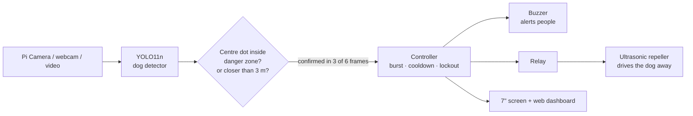

# AI-Powered Dog Detection & Repellent System

[](../../actions/workflows/ci.yml)
[](../../actions/workflows/arm64.yml)


**[العربية](README.ar.md)**

A Raspberry Pi watches a camera, recognises dogs with a YOLO neural network and, when a dog
comes too close, switches on an **ultrasonic repeller** (sound above human hearing that dogs
find unpleasant) to drive it away humanely. People are alerted with an audible buzzer and can
watch the live video on the 7" screen or on their phone.

Built for **kindergartens, schools, homes and other places where stray dogs are a danger to
children**. Graduation project, Faculty of Engineering, East Port Said National University.

<p align="center"></p>

## Try it in 1 minute (no hardware needed)

<p align="center"></p>

Children and a street cat pass (nothing happens). Then an Egyptian street dog walks up: the
buzzer beeps, the ultrasonic repeller fires in bursts, and the system calms down when it leaves.
The buzzer and relay are simulated; everything else is the real code that runs on the Pi.

| Where | How |
|---|---|
| **Your PC** (Windows / macOS / Linux, Python 3.10+) | the 4 commands below |
| **Browser only, nothing to install** | [](https://colab.research.google.com/github/mazenelnaghy-code/dog-detection/blob/main/notebooks/demo_colab.ipynb): run the demo and **upload your own photo** |
| **GitHub Codespaces** | [](https://codespaces.new/mazenelnaghy-code/dog-detection), then `python -m dog_repeller --demo --no-window` and open port 8000 |
| **Docker** | `docker build -t dog-repeller .` then `docker run --rm -p 8000:8000 dog-repeller`, open http://localhost:8000 |

```bash
git clone https://github.com/mazenelnaghy-code/dog-detection.git && cd dog-detection
python -m venv .venv && .venv\Scripts\activate       # Linux/macOS: source .venv/bin/activate
pip install -r requirements.txt && pip install --no-deps -e .
python -m dog_repeller --demo                         # video window + dashboard on http://127.0.0.1:8000
```

## How it works



1. **Detect.** YOLO11n (the *nano* version, fast enough for a Raspberry Pi) finds dogs in every
   frame. On the Pi it runs as an NCNN model, the fastest format for Pi CPUs. The original
   prototype used YOLOv8n, which still works. Tested on **236 Egyptian street-dog photos**, the
   stock model often called baladi dogs a "cow", "bear" or "sheep", so those look-alike labels
   also count as dogs. Cats and people never do. This raised dogs found from 72 % to **97 %**;
   see [docs/EVALUATION.md](docs/EVALUATION.md).
2. **Judge the danger.** A dot is placed at the centre of each dog's box. When the dot enters
   the **danger zone** drawn on the screen, or the dog's **estimated distance** is below
   `danger_distance_m`, the dog is dangerous. Distance comes from the camera itself (pinhole
   model `D = f·H / h`: the closer the dog, the taller its box), so no extra sensor is needed.
3. **Confirm.** The dog must be seen in at least 3 of the last 6 frames, so one bad frame never
   triggers the repeller.
4. **Act.** The buzzer beeps for people, and the relay switches the ultrasonic repeller ON for a
   5 s burst, then a 3 s pause, repeating while the dog stays. After 6 bursts in a row the system
   rests for 60 s, which protects the device and stops dogs getting used to the sound.

## Run on a PC with your camera or videos

After the install above:

```bash
python -m dog_repeller --sim                                                 # webcam 0
python -m dog_repeller --sim --source my_dog.mp4 --set camera.realtime=true  # a video, at real speed
python -m dog_repeller --sim --source samples/dogs --loop                    # a folder of photos
python -m dog_repeller --sim --source my_dog.mp4 --record result.mp4         # save the annotated video
```

`yolo11n.pt` downloads automatically the first time. Open **http://127.0.0.1:8000** for the
dashboard. In the video window: `q` quit, `a` arm, `d` disarm, `t` test the repeller. The
"switch" between test video and live camera is just `--source` (`0` webcam, `picamera` Pi camera).
`camera.realtime=true` plays a file like a live camera, so the repeller timings are real.

## Raspberry Pi setup

> **New to this?** Follow **[docs/GETTING_STARTED.md](docs/GETTING_STARTED.md)**: every step from an
> empty SD card to a working device, each with a check.

Raspberry Pi 4 or 5, Raspberry Pi OS 64-bit (Bookworm or newer), camera connected.

```bash
git clone https://github.com/mazenelnaghy-code/dog-detection.git ~/dog-detection && cd ~/dog-detection
bash deploy/setup_pi.sh            # starts automatically on boot (headless + dashboard)
bash deploy/setup_pi.sh desktop    # …or show the video full-screen on the HDMI screen
```

Run it as your normal user (not `sudo`). **Then check the hardware.** This tests the camera,
model speed, buzzer, relay, Pi temperature and power supply, and prints PASS/FAIL:

```bash
.venv/bin/python tools/hardware_check.py --config config/local.yaml
```

Then draw the danger zone on the real camera view (`tools/set_zone.py`) and follow the
step-by-step **[testing guide](docs/TESTING.md)**: bench test, watch-only days on site, then
arming the repeller with staff present.

The script installs everything, exports YOLO11n to NCNN, creates `config/local.yaml` with a
random dashboard password, and installs auto-start. At the end it prints the dashboard link
for your phone: `http://<pi-ip>:8000/?token=…`.

Useful commands: `journalctl -u dog-repeller -f` (live log), `sudo systemctl restart dog-repeller`.

<p align="center"></p>

**Wiring:** see [docs/WIRING.md](docs/WIRING.md), which has step-by-step assembly with a check after each step. In short: relay IN → **GPIO17**, buzzer →
**GPIO27**, 12 V repeller switched by the relay's COM/NO contacts. The parts list and how to choose
them are in [docs/HARDWARE.md](docs/HARDWARE.md).

## Configuration

Everything lives in [`config/default.yaml`](config/default.yaml) (PC) and
[`config/pi.yaml`](config/pi.yaml) (Pi, inherits the default). The most useful settings:

| Setting | Default | Meaning |
|---|---|---|
| `camera.source` | `"0"` / `picamera` | the switch: webcam, Pi camera, video file, folder, or URL |
| `model.path` | `yolo11n.pt` / NCNN | your fine-tuned model can be used here |
| `model.conf` | `0.25` | detection confidence threshold |
| `model.also_count` | `[bear, cow, sheep, …]` | look-alike labels that also count as a dog (never cat/person) |
| `zone.rect` | `[0.2, 0.4, 0.8, 1.0]` | danger zone as fractions of the frame (x1, y1, x2, y2) |
| `zone.rule` | `either` | `zone`, `distance`, `either`, `both` |
| `zone.focal_length_px` | `null` | from `tools/calibrate_focal.py`; enables the distance rule |
| `controller.burst_s` / `cooldown_s` | `5` / `3` | repeller ON time / pause |
| `buzzer.mode` | `detect` | beep for any dog, only `danger`, or `off` |
| `repeller.active_high` | `false` | most relay boards switch on a LOW signal |
| `repeller.watchdog_s` | `5` | safety: force the repeller OFF if the program freezes |

Any value can be overridden from the command line, e.g. `--set zone.rule=zone --set model.conf=0.3`.

**Distance calibration (optional):** stand 3 m from the camera, take a photo, then run
`python tools/calibrate_focal.py measure --image me.jpg --distance 3 --real-height 1.75` (your
height) and paste the printed `focal_length_px` into your config.

## Training your own model

The COCO-pretrained YOLO11n already detects dogs. Fine-tuning makes it a **dog specialist**:
dogs only, with **people and cats as negative examples** so children never trigger it, plus
**your own photos** of local street dogs. Everything is in [`training/`](training/README.md),
including a **Google Colab notebook** (free GPU) for people without a GPU:

```bash
python training/prepare_coco_dogs.py --out datasets/dogs --extra my_labelled_dogs/
python training/train.py --data datasets/dogs/data.yaml --epochs 60 --device 0
python training/export.py --weights models/dog_yolo11n.pt --format ncnn --imgsz 640
```

## Measured results

Tested on **real Egyptian street-dog photos**: 236 dogs, 113 children and 114 street cats from
Wikimedia Commons, every image checked by eye. The full report, method and limitations are in
[docs/EVALUATION.md](docs/EVALUATION.md).

| Setting | Dogs found | Child false alarms | Cat false alarms |
|---|---|---|---|
| Original prototype (YOLOv8n, class "dog" only, 640 px) | 69 % | 0 % | 12 % |
| **This project, PC (YOLO11n + look-alikes, 640 px)** | **97 %** | **4 %** | 15 % |
| **This project, Pi (YOLO11n NCNN, 640 px)** | **96 %** | **4 %** | 17 % |
| Simulated night (NoIR) / far away / motion blur | 81 % / 81 % / 62 % | 1–5 % | – |

These are single photos. The live system also requires the danger zone and 3-of-6-frame
confirmation. Of the 5 child photos that triggered, 2 had real animals in them (a donkey and
calves). On a Raspberry Pi 5, Ultralytics' published benchmarks suggest about 8–10 FPS at
640 px. **No real Pi has been measured yet**; run `tools/evaluate.py` on yours.

**Test on your own site:** record video where the device will stand, sort frames into `dogs/`
and `no_dogs/` folders, then run:

```bash
python tools/evaluate.py --dogs my_site/dogs --no-dogs my_site/no_dogs --variant none night
```

## Project structure

```
config/            default.yaml (PC/simulation) · pi.yaml (real hardware)
src/dog_repeller/
  app.py           main loop + command line
  sources.py       camera / video / folder / stream ("the switch")
  detector.py      YOLO wrapper, keeps only dogs
  zone.py          danger zone, centre dot, distance estimate
  controller.py    decides when to beep / repel (burst, cooldown, lockout)
  hardware.py      buzzer + relay (gpiozero or simulated)
  overlay.py       drawings on the video
  dashboard.py     web dashboard (live video, status, arm/disarm/test)
  demo.py          the built-in demo scene
samples/           public-domain photos of Egyptian street dogs, cats and children (demo + quick tests)
notebooks/         Colab: try-it demo (upload your photo) · model training on a free GPU
training/          dataset builder, training, export
deploy/            Raspberry Pi setup script, systemd service, desktop autostart
tools/
  hardware_check.py   self-test of a built device (camera, model FPS, buzzer, relay, power)
  set_zone.py         draw the danger zone with the mouse
  evaluate.py         dogs found / false alarms / speed on your own photo folders
  calibrate_focal.py  focal length for the distance estimate
  fetch_commons.py    download a freely-licensed test set
  make_gif.py         turn a --record video into a GIF
tests/             100+ unit and integration tests (no camera, GPU or Pi needed)
docs/              wiring, hardware, architecture, evaluation report, testing guide
Dockerfile, .devcontainer/   run the demo in Docker or GitHub Codespaces
```

Run the tests with `pip install -r requirements-dev.txt && python -m pytest`. Contributions are
welcome; see [CONTRIBUTING.md](CONTRIBUTING.md) and [CHANGELOG.md](CHANGELOG.md).

## Safety, ethics and privacy

- **Humane:** ultrasonic sound causes discomfort, not injury. Never use it continuously; the
  burst/cooldown/lockout timings are there for this reason.
- **Children:** young children hear higher frequencies than adults. Choose a repeller set to
  **≥ 23 kHz** and test it with the children's caretakers present.
- **Not every dog reacts:** deaf or very old dogs, and young puppies (as the original team noticed),
  may ignore it. This system helps, but it does **not** replace adult supervision.
- **Electrical:** the 12 V repeller circuit goes only through the relay contacts and never
  touches the Pi's pins. See [docs/WIRING.md](docs/WIRING.md).
- **Software fail-safes:** the relay is OFF at start, on errors and on exit. A watchdog thread
  also forces it OFF if the program ever freezes mid-burst.
- **Privacy:** the camera may see children. Nothing is recorded to disk. The dashboard listens
  only on the local network and is password-protected on the Pi (`dashboard.token`).

## Troubleshooting

| Problem | Fix |
|---|---|
| `numpy.dtype size changed` on the Pi | re-run `deploy/setup_pi.sh` (it pins NumPy to the system version) |
| Relay clicks ON during boot | use a *high-level trigger* relay board and set `repeller.active_high: true` |
| Relay never switches off | a 5 V active-low board may not see 3.3 V as "high": use a 3.3 V-compatible board |
| Too slow on the Pi (e.g. Pi 4) | re-export with `--imgsz 416` and set `model.imgsz: 416` |
| Street cats trigger it too often | remove `bear` from `model.also_count` (see docs/EVALUATION.md) |
| Dogs far away not detected | `model.imgsz: 640`, lower `model.conf`, or fine-tune with your own photos |
| No camera on the Pi | `rpicam-hello --list-cameras`; reseat the ribbon cable (contacts facing the right way) |

## Author

Maintained by **Mazen Elnaghy**, AI Engineering student at East Port Said National University
(Port Said, Egypt). [Portfolio](https://mazenelnaghy-code.github.io/#/projects/dog-deterrent) · [CV](https://mazenelnaghy-code.github.io/assets/Mazen_Elnaghy_CV.pdf) · [LinkedIn](https://linkedin.com/in/mazen-elnaghy) · [GitHub](https://github.com/mazenelnaghy-code)

## License

[MIT](LICENSE). The pretrained YOLO weights and the Ultralytics library are licensed by
Ultralytics under **AGPL-3.0**. Check their terms before any commercial use.
