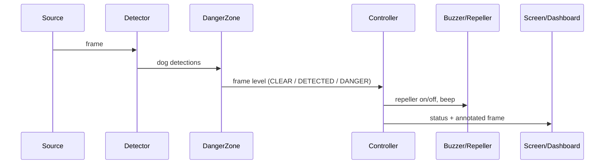
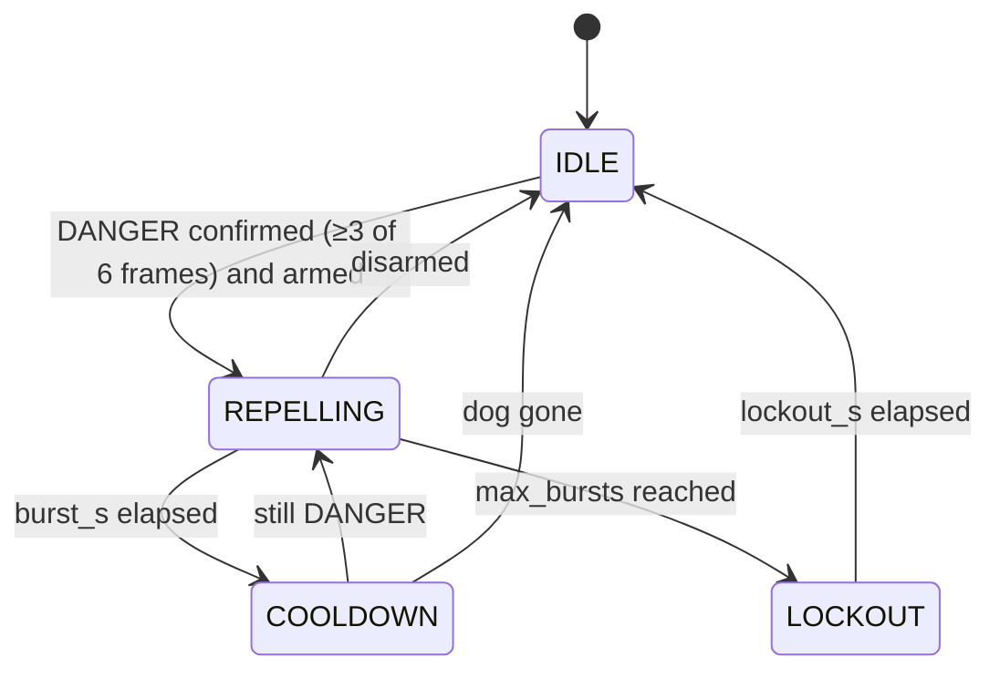

# Architecture

## Modules

Each file in `src/dog_repeller/` has one job. The decision logic is pure Python with no camera,
GPU or GPIO, so it is fully unit-tested on any computer.

| Module | Job | Talks to hardware? |
|---|---|---|
| `config.py` | YAML → typed dataclasses, `base:` inheritance, validation, `--set` overrides | no |
| `domain.py` | shared value types: `Detection`, `Threat`, `ThreatLevel`, `Commands` | no |
| `sources.py` | frames from Pi camera / webcam / stream / video / image folder | camera |
| `detector.py` | Ultralytics YOLO → list of dog `Detection`s (class-agnostic NMS, dog look-alike labels) | CPU/GPU |
| `zone.py` | centre dot, danger zone, pinhole distance → `Threat`s | no |
| `controller.py` | state machine → `Commands(repeller_on, beep)` | no |
| `hardware.py` | buzzer + relay with gpiozero or simulated pins, safety watchdog | GPIO |
| `overlay.py` | draw zone, boxes, dots, banner | no |
| `dashboard.py` | Flask: MJPEG video, status JSON, arm/disarm/test | network |
| `app.py` | main loop and command line | glue |

Heavy or Pi-only libraries (`ultralytics`, `picamera2`, `gpiozero`) are imported only inside the
functions that need them, so the tests and the CI never need them.

## One frame

## Controller state machine

- The **buzzer** beeps on the rising edge of the confirmed level (`detect` mode: any dog;
  `danger` mode: only dangerous dogs), at most once per `min_interval_s`.
- A **manual test** (dashboard button or `t` key) runs one burst, even when disarmed (but not
  during lockout), and is not counted as a real repel.

## Threads

| Thread | Does |
|---|---|
| main | read frame → detect → decide → outputs → draw |
| frame-grabber (live sources) | keeps only the newest camera frame, so detection never lags |
| dashboard (optional) | Werkzeug server, reads the shared `DashboardState` |
| gpiozero blink (on Pi) | buzzer beep pattern in the background |
| repeller-watchdog | forces the relay OFF if the main loop stops reporting while it is ON |

## Fail-safes

- Relay OFF at start, on any exception while switching, on exit, Ctrl-C and `systemctl stop`
  (SIGTERM).
- Relay wired Normally Open, so it is OFF while the Pi is off or booting.
- A watchdog thread switches the relay OFF if the main loop freezes for `repeller.watchdog_s`
  (default 5 s) while the repeller is ON.
- `max_bursts` + `lockout_s` cap continuous use.
- systemd always restarts the service (`Restart=always`, 5 s delay). The camera tolerates up to
  10 s without frames; after that the app exits with code 3 (camera lost) and systemd restarts it,
  which also re-opens the camera. A dashboard that cannot start (port in use) is logged and
  skipped; dog protection keeps running.

## Extending

A new output (an LED, a siren, a notification) goes in `App.step()` right after
`controller.update(...)`, reacting to `commands.repeller_on` / `commands.beep`. Add a config
dataclass in `config.py` for its settings and a test in `tests/test_app.py` using the
`FakeDetector` + `ListSource` helpers.
